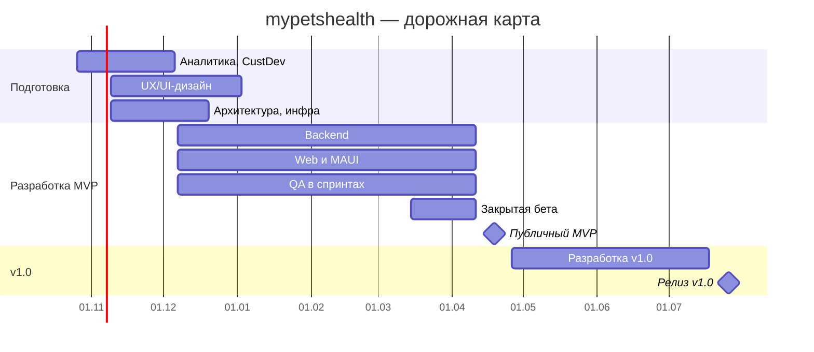

# mypetshealth — бэклог от идеи до релиза

Версия от 19 октября 2026

## Содержание

1. [Видение и зафиксированные решения](#1-видение-и-зафиксированные-решения)
2. [Стек и архитектурные принципы](#2-стек-и-архитектурные-принципы)
3. [Карта модулей](#3-карта-модулей)
4. [Ключевые user stories](#4-ключевые-user-stories)
5. [Этап 1. Аналитика и идея](#этап-1-аналитика-и-идея)
6. [Этап 2. Проектирование и UX/UI](#этап-2-проектирование-и-uxui)
7. [Этап 3. Архитектура и инфраструктура](#этап-3-архитектура-и-инфраструктура)
8. [Этап 4. Разработка Backend](#этап-4-разработка-backend)
9. [Этап 5. Разработка Frontend](#этап-5-разработка-frontend)
10. [Этап 6. Тестирование и QA](#этап-6-тестирование-и-qa)
11. [Этап 7. Деплой и релиз](#этап-7-деплой-и-релиз)
12. [Этап 8. Аналитика после запуска и поддержка](#этап-8-аналитика-после-запуска-и-поддержка)
13. [Дорожная карта, бюджет, риски](#9-дорожная-карта-бюджет-риски)

Обозначения: **(MVP)** — критично для MVP, **(v1.0)** — релиз v1.0, без метки — желательно, по мере возможности.

---

## 1. Видение и зафиксированные решения

**mypetshealth** — единая цифровая медкарта собаки или кошки, к которой владелец подключает любых врачей независимо от МИС клиник. Цель первого года: 500 активных питомцев, 20 подключённых врачей, retention владельцев на 30-й день ≥ 25%. MVP за 5–6 месяцев, v1.0 за 9–10 месяцев.

**Ценность для ролей**

- **Владелец:** вся история здоровья в одном месте, напоминания, контроль лечения и диеты, динамика анализов, консультации с врачом и ИИ, фотогалерея, документы.
- **Ветврач:** полная история пациента при подключении, протоколы приёма по шаблонам, чат и видео с владельцем.
- **Приют и волонтёры:** учёт животных от поступления до пристройства, витрина «Ищут дом», передача полной истории новому владельцу, доска задач.

**Freemium**

| Функция | Free | Premium |
| --- | --- | --- |
| Питомцы | 1 | без ограничений |
| Фото и файлы | 5 фото | 8 ГБ на аккаунт |
| Динамика показателей анализов | нет | да |
| ИИ-консультации | нет | да, с дневным лимитом |
| Распознавание бланков анализов (OCR) | нет | да |
| Свои ключи внешних ИИ-сервисов | нет | да |

В MVP лимиты работают, оплаты нет: Premium пилотам выдаётся вручную. Подписка на месяц и год, пробный период 14 дней. После окончания подписки данные сверх лимитов доступны только для чтения 1 год, затем удаляются из профиля.

**Юрисдикция и рынки**

- Хостинг: VPS в ОАЭ. Юрлицо: свободная зона ОАЭ (не DIFC и не ADGM).
- Пользователи: ОАЭ, Европа, Турция, СНГ. Применимое право: UAE PDPL, GDPR для пользователей из ЕС, KVKK для Турции. 152-ФЗ в MVP сознательно не учитываем, это принятый риск.
- Языки MVP: английский и русский, арабский с RTL в v1.1. i18n и RTL закладываются с первого спринта.
- Записи врача носят информационный характер, без электронной подписи и госинтеграций.

**Команда:** PM/BA (он же Product Owner), UX/UI-дизайнер, backend .NET, frontend Angular, MAUI-разработчик, QA, DevOps, ML-инженер. Полная занятость, работа за долю. Бюджет $200k идёт на инфраструктуру, GPU, юристов, сторы, бренд, маркетинг и резерв.

## 2. Стек и архитектурные принципы

Архитектура — модульный монолит на .NET с чёткими границами модулей. Его можно разделить на сервисы позже, а при цели 500 питомцев в первый год микросервисы не окупаются.

| Слой | Технология | Примечание по лицензии и рискам |
| --- | --- | --- |
| Web | Angular, Taiga UI, Angular SSR, Transloco | Apache 2.0 / MIT. SSR нужен для витрины «Ищут дом» |
| Mobile | .NET MAUI, MAUI Community Toolkit, SQLite | MIT. Отдельная UI-кодовая база, общий C#-код с backend |
| Backend | ASP.NET Core, EF Core, MediatR-подобный CQRS, FluentValidation, SignalR, Hangfire | Hangfire Core — LGPL. Альтернатива: Quartz.NET |
| Auth / SSO | Open.IdentityServer + ASP.NET Core Identity | Apache 2.0. Платные модули вендора (AdminUI и др.) не используем |
| БД | PostgreSQL | Плюс расширение pgvector для RAG по медкарте |
| Файлы | MinIO | AGPL. Фиксируем версию, при необходимости собираем образ сами |
| Поиск | ElasticSearch + Kibana | Выбрать вариант лицензии (AGPL), не предоставлять ES как сервис |
| Логи | Seq | Проприетарный. Проверить условия бесплатной лицензии |
| Метрики | Prometheus + Grafana | Apache 2.0 / AGPL |
| Ошибки | Sentry self-hosted | FSL, тяжёлый: от 16 ГБ RAM, отдельный VPS |
| Видео | Jitsi Meet self-hosted | Apache 2.0 |
| ИИ | vLLM + open-weight LLM и vision-модель; PaddleOCR | Apache 2.0. Плюс подключение внешних API и свои ключи пользователя |
| Push | FCM / APNs | Исключение из open source. В тексте push нет ПДн и медданных |
| Email | Postfix или Postal | Self-hosted, нужны SPF, DKIM, DMARC |
| Аналитика | Matomo или PostHog self-hosted | Решение на этапе 3 |
| PDF | PdfSharp/MigraDoc | MIT |
| CI/CD | GitHub, GitHub Actions + self-hosted runner, GHCR | Проекты в GitHub Projects |
| Хостинг | VPS в ОАЭ, Docker Compose | Окружения dev, stage, prod |

**Принципы**

1. Медкарта принадлежит владельцу. Любой доступ врача, приюта или совладельца — явный грант с журналом аудита.
2. Всё медицинское — модульные сущности с версионированием изменений: кто, когда, что изменил.
3. API-first: один REST API (OpenAPI) для web, mobile и Telegram-бота, клиент генерируется через NSwag.
4. Персональные и медицинские данные не покидают ОАЭ, кроме случаев, когда пользователь явно включил внешний ИИ-сервис или свой ключ.
5. i18n, RTL, мультивалютность и часовые пояса заложены с первого спринта.
6. Freemium-лимиты проверяются на backend через единый сервис entitlements, а не в клиентах.

## 3. Карта модулей

Продукт состоит из 21 модуля, у каждого есть MVP-часть. v1.0 (месяцы 7–10) добавляет развитие справочников, отзывов и отчётов. «Будущее» — бэклог после v1.0.

| Модуль | MVP | v1.0 | Будущее |
| --- | --- | --- | --- |
| M01 Аккаунты, SSO, роли | Регистрация, вход, 2FA, роли, резерв ролей грумера и кинолога | Вход через соцсети | Интерфейсы грумера и кинолога |
| M02 Профиль питомца | Профиль, ветпаспорт, документы со сроками, происхождение, чип | Публичная визитка питомца | Поиск по внешним реестрам чипов |
| M03 Доступы и аудит | QR и ссылки, уровни доступа, отзыв, совладелец и наблюдатель, журнал | Шаблоны доступа | — |
| M04 Медкарта | Прививки, обработки, хроника, аллергии, операции, вес, диагнозы с VeNom | — | — |
| M05 Приёмы | Факт приёма, протокол по шаблону, назначения | Свои шаблоны клиники | Онлайн-запись |
| M06 Анализы | Структурированный ввод, референсы, конвертация единиц, файлы, отклонения, динамика (Premium) | Расширение справочника | Интеграции с лабораториями |
| M07 OCR и распознавание (Premium) | Конвейер OCR + LLM с подтверждением | Новые типы бланков | — |
| M08 Лечение | Курсы, расписание, отметки, процент соблюдения, напоминания | — | — |
| M09 Питание | Рацион, добавки, отметки кормления, вес, личная база кормов | Общая база кормов с модерацией | Расчёт рациона |
| M10 Дрессировка | Дневник навыков, уровни 1–5 | — | Контент и кинологи |
| M11 Фотогалерея и файлы | Галерея, лимиты, хранение в MinIO | Альбомы | — |
| M12 Консультации | Чат владелец–врач, видео Jitsi | Платные консультации | Чаты остальных ролей |
| M13 ИИ-ассистент (Premium) | RAG по медкарте, объяснение анализов, внешние API и свои ключи | Тонкая настройка на ветданных | — |
| M14 Врачи и клиники | Верификация, профиль, клиники, каталог с поиском | Отзывы и рейтинг | — |
| M15 Приюты и волонтёры | Верификация, учёт животных, карточки, витрина, «Хочу забрать», доска задач, передача питомца | Анкеты кандидатов, отчёты приюта | Потеряшки с картой |
| M16 Уведомления | Push, email, Telegram с быстрыми отметками, настройки, тихие часы | — | Экспорт в календари |
| M17 Отчёты | Выписка из медкарты, история лечения, соблюдение (PDF) | Динамика анализов, Excel для приютов | — |
| M18 Подписки | Entitlements, лимиты, ручная выдача Premium | Оплата: веб-провайдер, App Store, Google Play | — |
| M19 Модерация и админка | Верификации, жалобы, справочники, пользователи, клиенты SSO | Модерация базы кормов | — |
| M20 Офлайн (mobile) | Медкарта, отметки лечения, диета, аллергии | — | Полный офлайн |
| M21 i18n | EN, RU | AR с RTL | Турецкий и другие |

## 4. Ключевые user stories

Формат: «Как <роль>, я хочу <действие>, чтобы <ценность>». Критерии приёмки детализируются в задачах этапа 1. Все истории ниже относятся к MVP, кроме отмеченных (v1.0).

**Владелец**

- US-01. Как владелец, я хочу зарегистрироваться по email и подтвердить его, чтобы получить защищённый аккаунт.
- US-02. Как владелец, я хочу создать профиль питомца с фото, породой, чипом, ветпаспортом и происхождением, чтобы все данные были в одном месте.
- US-03. Как владелец, я хочу загрузить сканы документов со сроком действия, чтобы получить напоминание до его истечения.
- US-04. Как владелец, я хочу вести прививки, обработки, аллергии и хронические болезни, чтобы показать врачу полную историю.
- US-05. Как владелец, я хочу внести результаты анализов вручную или загрузить бланк, чтобы видеть отклонения от нормы.
- US-06. Как владелец Premium, я хочу распознать бланк анализа с фото и проверить значения, чтобы не вводить их вручную.
- US-07. Как владелец Premium, я хочу видеть графики динамики показателей, чтобы отслеживать эффект лечения.
- US-08. Как владелец, я хочу получать напоминания о приёме препарата и отмечать «дал», чтобы не пропустить дозу.
- US-09. Как владелец, я хочу вести рацион с добавками и отмечать кормления, чтобы соблюдать диету врача.
- US-10. Как владелец, я хочу выдать врачу доступ по QR-коду на время и отозвать его, чтобы контролировать свои данные.
- US-11. Как владелец, я хочу добавить члена семьи совладельцем или наблюдателем, чтобы уход был общим.
- US-12. Как владелец, я хочу написать врачу в чат или созвониться по видео, чтобы быстро получить консультацию.
- US-13. Как владелец Premium, я хочу задать вопрос ИИ по карте питомца, чтобы понять результаты анализов до визита.
- US-14. Как владелец Premium, я хочу подключить свой ключ внешнего ИИ-сервиса, чтобы использовать предпочитаемую модель.
- US-15. Как владелец, я хочу видеть диету, аллергии и курс лечения без интернета, чтобы ухаживать за питомцем в поездке.
- US-16. Как владелец, я хочу скачать выписку из медкарты в PDF, чтобы передать её в любую клинику.
- US-17. Как владелец, я хочу вести дневник навыков дрессировки, чтобы видеть прогресс.
- US-18. Как владелец, я хочу настроить каналы уведомлений и тихие часы, чтобы получать только важное.
- US-19. Как владелец, я хочу отмечать приём лекарства прямо из Telegram, чтобы не открывать приложение.

**Ветврач и клиника**

- US-20. Как врач, я хочу загрузить диплом и пройти верификацию, чтобы получить право вносить записи.
- US-21. Как врач, я хочу открыть карту питомца по QR-коду владельца, чтобы сразу видеть историю.
- US-22. Как врач, я хочу заполнить протокол приёма по шаблону с диагнозом из классификатора, чтобы тратить меньше времени.
- US-23. Как врач, я хочу назначить курс лечения и диету, чтобы владелец получил расписание и напоминания.
- US-24. Как врач, я хочу видеть процент соблюдения лечения, чтобы корректировать назначения.
- US-25. Как администратор клиники, я хочу привязать врачей к клинике, чтобы клиника была видна в каталоге.
- US-26. Как владелец, я хочу найти врача в каталоге по специализации и городу, чтобы подключить его к карте.
- US-27. (v1.0) Как владелец, я хочу оставить отзыв после консультации, чтобы помочь другим выбрать врача.

**Приют и волонтёры**

- US-28. Как администратор приюта, я хочу пройти верификацию организации, чтобы публиковать животных.
- US-29. Как сотрудник приюта, я хочу провести животное по этапам (поступление, карантин, лечение, стерилизация, пристройство), чтобы видеть статус каждого.
- US-30. Как сотрудник приюта, я хочу опубликовать карточку на витрине «Ищут дом», чтобы найти хозяина.
- US-31. Как посетитель без регистрации, я хочу искать животных на витрине по виду, возрасту и городу, чтобы выбрать питомца.
- US-32. Как кандидат, я хочу нажать «Хочу забрать» и оставить контакты, чтобы приют со мной связался.
- US-33. Как сотрудник приюта, я хочу передать животное новому владельцу с полной историей, чтобы лечение продолжилось без потерь.
- US-34. Как сотрудник приюта, я хочу создавать задачи для волонтёров, чтобы закрывать потребности приюта.
- US-35. Как волонтёр, я хочу откликнуться на задачу и получить подтверждение, чтобы планировать время.

**Платформа**

- US-36. Как модератор, я хочу проверять документы врачей и приютов, чтобы на платформе были только подтверждённые специалисты.
- US-37. Как модератор, я хочу обрабатывать жалобы на контент, чтобы витрина и профили оставались корректными.
- US-38. Как администратор, я хочу вручную выдавать Premium пилотным пользователям, чтобы тестировать платные функции до запуска оплаты.
- US-39. Как владелец, я хочу удалить аккаунт и получить экспорт данных, чтобы реализовать свои права по GDPR и PDPL.

---

## Этап 1. Аналитика и идея

Срок: спринты 0–2 (недели 1–6). Результат этапа: утверждённый MVP-scope, бэклог с критериями приёмки и юридическая карта рисков.

**1.1. Управление продуктом**

- [ ] (MVP) Утвердить Product Vision Board: проблема, ЦА, ценность, метрики, монетизация — документ подписан PO.
- [ ] (MVP) Утвердить North Star Metric (еженедельно активные питомцы с хотя бы одним действием) и дерево метрик.
- [ ] (MVP) Настроить GitHub Projects: эпики M01–M21, шаблоны задач (story, bug, spike, tech debt), поля Priority, Estimate, Release.
- [ ] (MVP) Утвердить Definition of Ready и Definition of Done (код-ревью, тесты, i18n-ключи, документация API, демо).
- [ ] (MVP) Утвердить ритуалы Scrum: планирование, дейли, ревью, ретро; календарь спринтов по 2 недели на 10 месяцев.
- [ ] (MVP) Сформировать реестр рисков и допущений, назначить владельцев рисков.
- [ ] Подготовить план бюджета $200k по статьям и квартальный cash-flow.

**1.2. CustDev с пилотами (8 партнёров, 28 ожидающих)**

- [ ] (MVP) Составить гайд интервью для 4 сегментов: владельцы, врачи, приюты, волонтёры.
- [ ] (MVP) Провести 8 интервью с пилотными партнёрами и 12–15 с ожидающими владельцами, записи и заметки в общем репозитории.
- [ ] (MVP) Синтезировать результаты: карта болей, Jobs To Be Done, топ-10 сценариев по частоте и боли.
- [ ] (MVP) Провести опрос готовности платить за Premium (цена, состав), не менее 30 ответов.
- [ ] (MVP) Подписать с пилотами соглашения об участии в бете (сроки, обратная связь, конфиденциальность).
- [ ] Провести конкурентный анализ 5–7 аналогов: функции, цены, отзывы в сторах; итог — таблица отличий.

**1.3. Scope MVP и требования**

- [ ] (MVP) Провести story mapping всех ролей, отсечь MVP-линию, утвердить с PO.
- [ ] (MVP) Детализировать US-01…US-39: критерии приёмки в формате Given/When/Then.
- [ ] (MVP) Описать матрицу прав «роль × сущность × действие» для всех 10 ролей, включая резервные.
- [ ] (MVP) Описать модель доступа к медкарте: гранты, срок, уровень, отзыв, наследование при передаче питомца.
- [ ] (MVP) Описать жизненный цикл сущностей: питомец, курс лечения, анализ, животное приюта, задача волонтёра, подписка.
- [ ] (MVP) Описать правила freemium-лимитов и поведение при окончании подписки (чтение 1 год, затем удаление).
- [ ] (MVP) Описать каталог уведомлений: событие, получатель, канал, текст EN и RU, тихие часы.
- [ ] (MVP) Описать нефункциональные требования: SLA 99,5%, RPO 1 ч, RTO 4 ч, время ответа API p95 < 300 мс, рост до 50 тыс. пользователей.
- [ ] (MVP) Описать требования к офлайн-режиму MAUI и правила разрешения конфликтов синхронизации.
- [ ] (MVP) Составить глоссарий домена на EN и RU.

**1.4. Медицинские справочники**

- [ ] (MVP) Заключить соглашение с ветеринаром-консультантом из пилотов на выверку справочников.
- [ ] (MVP) Проверить лицензию VeNom Codes для коммерческого использования; при отказе утвердить свой справочник диагнозов.
- [ ] (MVP) Собрать справочник показателей анализов (ОАК, биохимия, ОАМ, гормоны) с референсами по виду, возрасту и полу и единицами измерения.
- [ ] (MVP) Собрать справочники: виды, породы (FCI и фелинологические системы), прививки, обработки, препараты, типы документов.
- [ ] (MVP) Утвердить шаблоны протоколов осмотра (не менее 3: первичный, повторный, вакцинация).
- [ ] (MVP) Собрать справочник базовых команд дрессировки.

**1.5. Юридическая часть**

- [ ] (MVP) Зарегистрировать юрлицо в свободной зоне ОАЭ и получить банковский счёт.
- [ ] (MVP) Получить консультацию юриста по UAE PDPL, GDPR (передача данных из ЕС в ОАЭ, SCC) и турецкому KVKK.
- [ ] (MVP) Подготовить оферту, политику конфиденциальности, согласие на обработку ПДн, cookie-политику на EN и RU.
- [ ] (MVP) Подготовить дисклеймеры: «ИИ не ставит диагноз», «записи носят информационный характер».
- [ ] (MVP) Провести DPIA (оценку воздействия на защиту данных) и вести реестр операций обработки.
- [ ] (MVP) Подготовить согласие пользователя на передачу данных во внешние ИИ-сервисы и при использовании своих ключей.
- [ ] (MVP) Подготовить соглашение с врачами и приютами (ответственность, верификация, правила платформы).
- [ ] (MVP) Проверить лицензии всех компонентов стека (Seq, Elastic, MinIO, Sentry, Hangfire) и зафиксировать заключение.
- [ ] Зарегистрировать товарный знак mypetshealth в ОАЭ.
- [ ] Зафиксировать принятый риск по 152-ФЗ и план второго контура хранения для РФ.

## Этап 2. Проектирование и UX/UI

Срок: спринты 1–4 (недели 3–10), дальше дизайн идёт на спринт впереди разработки. Результат: дизайн-система в двух реализациях и протестированные макеты всех MVP-сценариев. Инструмент: Penpot (open source).

**2.1. Бренд**

- [ ] (MVP) Проверить доступность имени mypetshealth: домены, сторы, соцсети, товарные знаки; утвердить название.
- [ ] (MVP) Купить домены (.com и резервные) и зарезервировать имя в App Store, Google Play и Telegram.
- [ ] (MVP) Разработать логотип, иконку приложения, палитру, типографику; иконка соответствует требованиям обоих сторов.
- [ ] (MVP) Утвердить тон коммуникации и правила текстов на EN и RU.

**2.2. Информационная архитектура**

- [ ] (MVP) Построить карту экранов web и mobile для всех ролей.
- [ ] (MVP) Спроектировать навигацию: мультипитомец, переключение ролей у одного пользователя (владелец и волонтёр).
- [ ] (MVP) Нарисовать user flow: онбординг, добавление питомца, выдача доступа по QR, ввод анализа, распознавание бланка, курс лечения, передача питомца, верификация врача.
- [ ] (MVP) Нарисовать user flow: приём у врача, чат и видео, ИИ-ассистент с эскалацией к врачу.
- [ ] (MVP) Нарисовать user flow приюта: поступление → карантин → лечение → стерилизация → витрина → «Хочу забрать» → передача.

**2.3. Вайрфреймы**

- [ ] (MVP) Подготовить low-fi вайрфреймы всех MVP-экранов web (адаптив 360, 768, 1280 px).
- [ ] (MVP) Подготовить low-fi вайрфреймы всех MVP-экранов mobile (iOS и Android).
- [ ] (MVP) Провести 5 коридорных тестов вайрфреймов с пилотами, внести правки.

**2.4. Дизайн-система**

- [ ] (MVP) Определить дизайн-токены: цвета (светлая и тёмная темы), типографика, отступы, радиусы, тени, иконки.
- [ ] (MVP) Настроить тему Taiga UI на токенах и задокументировать соответствие компонентов.
- [ ] (MVP) Перенести токены в MAUI ResourceDictionary и стили; составить библиотеку MAUI-компонентов (кнопки, поля, карточки, списки, чипы, модалки).
- [ ] (MVP) Спроектировать компоненты домена: карточка питомца, таймлайн медкарты, график показателя с референсной зоной, карточка дозы, QR-грант.
- [ ] (MVP) Заложить RTL-зеркалирование в правила вёрстки (логические свойства CSS, FlowDirection в MAUI).
- [ ] (MVP) Определить состояния: пусто, загрузка, ошибка, офлайн, лимит freemium (paywall).
- [ ] Проверить контраст и размеры по WCAG 2.1 AA (базовая доступность).

**2.5. Макеты**

- [ ] (MVP) Нарисовать hi-fi макеты онбординга, профиля питомца, медкарты, документов, галереи.
- [ ] (MVP) Нарисовать hi-fi макеты анализов: ввод, распознавание с подтверждением, отклонения, графики.
- [ ] (MVP) Нарисовать hi-fi макеты лечения, питания, дрессировки, напоминаний.
- [ ] (MVP) Нарисовать hi-fi макеты кабинета врача: пациенты, протокол приёма, назначения, чат, видео.
- [ ] (MVP) Нарисовать hi-fi макеты приюта, витрины (SEO-страницы), доски волонтёров.
- [ ] (MVP) Нарисовать hi-fi макеты ИИ-ассистента, настроек уведомлений, Premium и paywall.
- [ ] (MVP) Нарисовать hi-fi макеты админки: верификации, жалобы, справочники, пользователи, выдача Premium.
- [ ] (MVP) Подготовить шаблоны PDF-отчётов и email-писем EN и RU.
- [ ] (MVP) Собрать кликабельный прототип ключевых сценариев и провести юзабилити-тест с 5 владельцами и 3 врачами.
- [ ] (MVP) Передать макеты в разработку: спецификации отступов, состояний и анимаций, экспорт ассетов.
- [ ] Подготовить скриншоты и тексты для страниц в App Store и Google Play.
- [ ] Нарисовать лендинг продукта (EN и RU) со страницами для врачей и приютов.

## Этап 3. Архитектура и инфраструктура

Срок: спринты 1–3 (недели 3–8), развитие по ходу проекта. Результат: работающие окружения dev и stage, CI/CD, наблюдаемость и утверждённые архитектурные решения (ADR).

**3.1. Архитектурные решения**

- [ ] (MVP) Составить C4-диаграммы: контекст, контейнеры, компоненты модульного монолита.
- [ ] (MVP) Зафиксировать ADR: модульный монолит, CQRS, REST + OpenAPI, SignalR, фоновые задачи, хранение файлов, стратегия поиска.
- [ ] (MVP) Определить границы модулей M01–M21 и правила взаимодействия (внутренние контракты, доменные события, outbox).
- [ ] (MVP) Утвердить структуру решения: Api, Modules/\*, SharedKernel, Contracts (общий с MAUI), IdentityServer, Workers, AiGateway.
- [ ] (MVP) Утвердить стратегию версионирования API (/v1) и обратной совместимости для мобильных клиентов.
- [ ] (MVP) Утвердить стратегию офлайн-синхронизации: дельты по меткам времени, разрешение конфликтов, очередь исходящих действий.
- [ ] (MVP) Спроектировать AI Gateway: маршрутизация между self-hosted моделью, внешними API и ключами пользователя; учёт лимитов; журнал диалогов.

**3.2. Модель данных (PostgreSQL)**

- [ ] (MVP) Спроектировать ER-модель: User, Pet, PetOwnership, AccessGrant, AuditLog, Document, Passport, Origin, Chip.
- [ ] (MVP) Спроектировать медицинские сущности: Vaccination, Treatment (обработка), Condition, Allergy, Surgery, WeightRecord, Diagnosis (VeNom + свободный текст + теги).
- [ ] (MVP) Спроектировать Visit, VisitProtocol, ProtocolTemplate, Prescription.
- [ ] (MVP) Спроектировать LabTest, LabResult, LabParameter, ReferenceRange (вид, возраст, пол), Unit, UnitConversion, LabOverrideRange.
- [ ] (MVP) Спроектировать TreatmentCourse, DoseSchedule, DoseEvent, Diet, DietItem, Supplement, FeedingEvent, FoodItem (личный и общий).
- [ ] (MVP) Спроектировать Vet, Clinic, VetClinic, Verification, Shelter, ShelterAnimal, ShelterStage, AdoptionRequest, Volunteer, VolunteerTask, TaskResponse.
- [ ] (MVP) Спроектировать Conversation, Message, VideoSession, AiConversation, AiMessage, UserApiKey (зашифрованный).
- [ ] (MVP) Спроектировать Subscription, Entitlement, UsageQuota, NotificationPreference, NotificationLog, Report.
- [ ] (MVP) Спроектировать мультиязычные справочники (таблицы переводов) и soft delete с датой окончательного удаления.
- [ ] (MVP) Утвердить стратегию миграций EF Core и сиды справочников.
- [ ] (MVP) Определить индексы и партиционирование AuditLog и NotificationLog по месяцам.

**3.3. Хранилища и поиск**

- [ ] (MVP) Спроектировать бакеты MinIO: фото, документы, бланки анализов, отчёты; политики доступа через presigned URL; шифрование на стороне сервера.
- [ ] (MVP) Спроектировать индексы ElasticSearch: витрина животных, каталог врачей и клиник, справочники; анализаторы EN и RU, позже AR.
- [ ] (MVP) Спроектировать синхронизацию PostgreSQL → ElasticSearch через outbox и фоновый воркер.

**3.4. Хостинг и окружения**

- [ ] (MVP) Выбрать провайдера VPS в ОАЭ: цена, SLA, локация дата-центра, наличие GPU; утвердить смету.
- [ ] (MVP) Спланировать топологию prod: app-VPS, db-VPS, storage-VPS, observability-VPS (Sentry, Seq, ELK, Grafana), GPU-сервер, backup-VPS в другом дата-центре ОАЭ.
- [ ] (MVP) Поднять окружение dev+stage на одном VPS через Docker Compose.
- [ ] (MVP) Настроить reverse proxy (Traefik или Nginx), TLS через Let's Encrypt, домены и поддомены (app, api, id, meet, admin).
- [ ] (MVP) Настроить firewall, SSH только по ключам, fail2ban, приватную сеть между VPS.
- [ ] (MVP) Настроить хранение секретов: GitHub Secrets для CI, Docker secrets или SOPS на серверах.

**3.5. CI/CD**

- [ ] (MVP) Создать репозитории (monorepo или backend, web, mobile, infra), правила веток, защиту main, шаблоны PR.
- [ ] (MVP) Настроить self-hosted runner GitHub Actions на VPS.
- [ ] (MVP) Пайплайн backend: build, unit-тесты, интеграционные тесты (Testcontainers), анализ кода, Docker-образ в GHCR.
- [ ] (MVP) Пайплайн web: lint, unit-тесты, build SSR, Docker-образ.
- [ ] (MVP) Пайплайн MAUI: сборка Android (AAB) и iOS (IPA, macOS-runner), подпись, выгрузка в TestFlight и Google Play Internal Testing.
- [ ] (MVP) Пайплайн деплоя: auto в dev, ручное подтверждение в stage и prod, миграции БД отдельным шагом, откат на предыдущий образ.
- [ ] (MVP) Настроить сканирование зависимостей и образов (Dependabot, Trivy) и проверку лицензий.

**3.6. Наблюдаемость**

- [ ] (MVP) Подключить Serilog с отправкой в Seq; correlation id через все сервисы.
- [ ] (MVP) Поднять Prometheus + Grafana: метрики .NET, PostgreSQL, MinIO, Elastic, GPU; дашборды по сервисам.
- [ ] (MVP) Поднять Sentry self-hosted, подключить backend, Angular и MAUI (краши, производительность).
- [ ] (MVP) Поднять Kibana для анализа поиска и логов доступа.
- [ ] (MVP) Настроить алерты: недоступность, ошибки 5xx > 1%, p95 > 500 мс, диск > 80%, бэкап не выполнен; уведомления в Telegram команды.
- [ ] Поднять статус-страницу (Uptime Kuma).

**3.7. Безопасность и данные**

- [ ] (MVP) Провести моделирование угроз (STRIDE) для медкарты, грантов доступа, ИИ и файлов.
- [ ] (MVP) Настроить бэкапы PostgreSQL (pgBackRest: полный ежедневно + WAL для RPO 1 ч) и репликацию MinIO на backup-VPS.
- [ ] (MVP) Написать и проверить runbook восстановления из бэкапа (RTO 4 ч).
- [ ] (MVP) Определить шифрование: TLS везде, шифрование дисков, шифрование пользовательских API-ключей в БД.
- [ ] (MVP) Определить политику хранения: логи 90 дней, аудит 3 года, удалённые данные — по правилам freemium и GDPR.

## Этап 4. Разработка Backend

Срок: спринты 3–11 (недели 7–24). Каждая задача закрывается с unit- и интеграционными тестами, описанием в OpenAPI и i18n-ключами ошибок.

**4.1. Каркас**

- [ ] (MVP) Создать решение .NET: модульный монолит, SharedKernel, Contracts, общая обработка ошибок (ProblemDetails), валидация, пагинация, фильтрация.
- [ ] (MVP) Подключить EF Core + PostgreSQL, миграции, сиды справочников, аудит изменений сущностей (кто, когда, что).
- [ ] (MVP) Реализовать outbox и доменные события между модулями.
- [ ] (MVP) Подключить фоновые задачи (Hangfire или Quartz.NET): напоминания, рассылки, синхронизация поиска, очистка данных.
- [ ] (MVP) Подключить локализацию ответов API (EN, RU) по Accept-Language и часовые пояса пользователя.
- [ ] (MVP) Настроить rate limiting, CORS, заголовки безопасности, health checks (/health/live, /health/ready).

**4.2. M01 Идентификация (Open.IdentityServer)**

- [ ] (MVP) Поднять IdentityServer на Open.IdentityServer + ASP.NET Core Identity с хранением в PostgreSQL.
- [ ] (MVP) Настроить клиенты: Angular (Authorization Code + PKCE), MAUI (Code + PKCE, системный браузер), Telegram-бот, внутренние сервисы (client credentials).
- [ ] (MVP) Реализовать регистрацию, подтверждение email, восстановление пароля, смену email.
- [ ] (MVP) Реализовать 2FA (TOTP), обязательную для врачей, приютов и админов.
- [ ] (MVP) Реализовать роли и scopes для 10 ролей, включая резервные «грумер» и «кинолог».
- [ ] (MVP) Реализовать собственную админку клиентов, ролей и пользователей (без платного AdminUI).
- [ ] (MVP) Реализовать журнал входов и подозрительной активности с отправкой в Seq.
- [ ] Реализовать вход через Google и Apple (обязателен для iOS при наличии соцсетей).

**4.3. M02–M04 Питомец, доступы, медкарта**

- [ ] (MVP) API профиля питомца: CRUD, фото, порода, чип, ветпаспорт, происхождение, мультипитомец с проверкой лимита.
- [ ] (MVP) API документов: загрузка в MinIO, тип, номер, срок действия, напоминания за 30 и 7 дней.
- [ ] (MVP) API совладельцев и наблюдателей: приглашение, принятие, права, удаление.
- [ ] (MVP) API грантов доступа: генерация QR и ссылки с TTL, уровень (чтение / запись), отзыв, список активных грантов.
- [ ] (MVP) Авторизация на уровне ресурса: каждый запрос к медкарте проверяет грант; запись в AuditLog для чтения и изменения.
- [ ] (MVP) API медкарты: прививки, обработки, хронические заболевания, аллергии, операции, вес; таймлайн событий.
- [ ] (MVP) API диагнозов: поиск по VeNom, свободный текст, теги.
- [ ] (MVP) API передачи питомца: запрос, подтверждение обеими сторонами, перенос истории, отзыв старых грантов.

**4.4. M05–M07 Приёмы и анализы**

- [ ] (MVP) API приёма: протокол по шаблону, диагнозы, назначения, файлы; запись разрешена только верифицированному врачу с грантом на запись.
- [ ] (MVP) API шаблонов протоколов: системные и личные шаблоны врача.
- [ ] (MVP) API анализов: создание, ввод показателей, выбор референса (по справочнику или с бланка), конвертация единиц, флаги отклонения.
- [ ] (MVP) API динамики: временные ряды по показателю, доступ только с entitlement Premium.
- [ ] (MVP) Конвейер распознавания (Premium): загрузка → PaddleOCR → vision-LLM → сопоставление со справочником → черновик → подтверждение пользователем.
- [ ] (MVP) Метрики качества распознавания: доля исправленных пользователем значений по каждому типу бланка.

**4.5. M08–M11 Лечение, питание, дрессировка, галерея**

- [ ] (MVP) API курсов лечения: препарат из справочника или свободный текст, дозировка, расписание (RRULE), длительность.
- [ ] (MVP) Генератор событий доз и напоминаний с учётом часового пояса и тихих часов.
- [ ] (MVP) API отметок «дал / пропустил» с источником (app, web, Telegram) и расчёт процента соблюдения.
- [ ] (MVP) API рациона: корма и добавки, порции, время; назначение врачом или владельцем; запрет изменения диеты врача владельцем.
- [ ] (MVP) API отметок кормления и веса, расчёт соблюдения диеты.
- [ ] (MVP) API личной базы кормов и добавок пользователя.
- [ ] (MVP) API дневника дрессировки: навыки из справочника и свои, уровень 1–5, заметки.
- [ ] (MVP) API галереи: загрузка с генерацией превью, удаление, квоты (5 фото Free, 8 ГБ Premium).

**4.6. M12–M13 Консультации и ИИ**

- [ ] (MVP) Чат владелец–врач на SignalR: сообщения, вложения (фото, PDF), статусы доставки и прочтения, статус врача «онлайн / не беспокоить».
- [ ] (MVP) Интеграция с Jitsi Meet: создание комнаты с JWT-доступом только для участников, ссылка в чате.
- [ ] (MVP) Развернуть vLLM с open-weight моделью на GPU-сервере; выбрать модель по качеству на EN и RU (бенчмарк на 50 вопросах от ветеринара).
- [ ] (MVP) RAG по медкарте: векторизация записей в pgvector, отбор контекста только по питомцу с грантом.
- [ ] (MVP) AI Gateway: провайдеры (self-hosted, внешние API, ключ пользователя), согласие на передачу данных, дневные лимиты, журнал диалогов.
- [ ] (MVP) Хранение ключей пользователей в зашифрованном виде, проверка ключа при сохранении.
- [ ] (MVP) Guardrails: системный дисклеймер, запрет постановки диагноза, фильтр опасных советов, кнопка эскалации в чат с врачом.

**4.7. M14–M15 Врачи, клиники, приюты**

- [ ] (MVP) API верификации врачей и приютов: загрузка документов, статусы, комментарий модератора, уведомления.
- [ ] (MVP) API клиник: создание, привязка врачей (многие ко многим), видимость списка врачей и пациентов без медзаписей.
- [ ] (MVP) API каталога врачей и клиник с поиском в ElasticSearch (специализация, город, язык).
- [ ] (MVP) API приюта: сотрудники и роли, животные приюта, этапы (поступление, карантин, лечение, стерилизация, пристройство) с историей переходов.
- [ ] (MVP) Публичный API витрины «Ищут дом» с поиском и фильтрами; SEO-данные (slug, мета, schema.org).
- [ ] (MVP) API «Хочу забрать»: заявка с контактами, уведомление приюту, статусы.
- [ ] (MVP) API задач волонтёров: создание, отклик, подтверждение приютом, завершение, уведомления.
- [ ] (v1.0) API отзывов и рейтинга после подтверждённого взаимодействия, жалобы и пост-модерация.

**4.8. M16–M19 Уведомления, отчёты, подписки, админка**

- [ ] (MVP) Сервис уведомлений: шаблоны EN и RU, каналы push (FCM/APNs без ПДн в тексте), email, Telegram; настройки по типам событий; тихие часы; ретраи.
- [ ] (MVP) Telegram-бот: привязка аккаунта по одноразовому коду, уведомления, быстрые отметки дозы и кормления.
- [ ] (MVP) Email через собственный Postfix или Postal: SPF, DKIM, DMARC, отписка, мониторинг доставляемости.
- [ ] (MVP) Генерация PDF-отчётов (PdfSharp/MigraDoc): выписка из медкарты, история лечения, соблюдение; EN и RU.
- [ ] (MVP) Сервис entitlements: проверка лимитов (питомцы, фото, квота 8 ГБ, ИИ, динамика, OCR) на каждом запросе.
- [ ] (MVP) Жизненный цикл подписки: пробный период, активна, истекла (только чтение), удаление данных сверх лимитов через 1 год.
- [ ] (MVP) Ручная выдача Premium администратором с журналом.
- [ ] (MVP) API модерации: очереди верификаций, жалобы, блокировки, редактирование справочников.
- [ ] (MVP) Права субъекта данных: экспорт данных (JSON + PDF), удаление аккаунта, журнал согласий.
- [ ] (v1.0) Интеграция оплаты: веб-провайдер, App Store Server Notifications, Google Play Real-time Developer Notifications, сверка подписок.
- [ ] (v1.0) Общая база кормов с модерацией и предложениями от пользователей и врачей.

**4.9. M20 Синхронизация для офлайна**

- [ ] (MVP) API дельта-синхронизации: медкарта, активные курсы, диета, аллергии; токен последней синхронизации.
- [ ] (MVP) Приём пакета офлайн-отметок с идемпотентными ключами и разрешением конфликтов.

## Этап 5. Разработка Frontend

Срок: спринты 3–11 (недели 7–24), web и mobile идут параллельно, мобилка отстаёт от backend на 1 спринт. Клиенты API генерируются из OpenAPI (NSwag) при каждой сборке.

**5.1. Web: каркас (Angular + Taiga UI)**

- [ ] (MVP) Создать Angular-приложение (standalone-компоненты, строгий TypeScript), подключить Taiga UI с темой на токенах.
- [ ] (MVP) Настроить стейт-менеджмент (NgRx SignalStore): сессия, текущий питомец, entitlements, уведомления.
- [ ] (MVP) Подключить OIDC (angular-auth-oidc-client): вход, silent refresh, guards по ролям, interceptor с токеном.
- [ ] (MVP) Подключить Transloco (EN, RU), форматирование дат, чисел и единиц по локали; RTL-готовая вёрстка на логических свойствах CSS.
- [ ] (MVP) Настроить Angular SSR для публичной витрины и каталога, sitemap.xml, robots.txt, мета-теги, hreflang.
- [ ] (MVP) Общие компоненты: лэйаут по ролям, переключатель питомцев, загрузчик файлов с прогрессом, paywall, пустые состояния, обработка ошибок.
- [ ] (MVP) Подключить Sentry и Matomo или PostHog с согласием на cookie.

**5.2. Web: экраны владельца**

- [ ] (MVP) Онбординг, регистрация, 2FA, профиль пользователя, удаление аккаунта и экспорт данных.
- [ ] (MVP) Профиль питомца, ветпаспорт, документы со сроками, происхождение, чип.
- [ ] (MVP) Медкарта: таймлайн, прививки, обработки, хроника, аллергии, операции, график веса.
- [ ] (MVP) Анализы: ручной ввод по справочнику, отклонения, загрузка бланка, экран подтверждения распознавания (Premium).
- [ ] (MVP) Графики динамики показателей с референсной зоной (ngx-charts или ECharts, Apache 2.0) — Premium.
- [ ] (MVP) Курсы лечения, календарь доз, отметки, процент соблюдения.
- [ ] (MVP) Рацион и добавки, отметки кормления, личная база кормов.
- [ ] (MVP) Дневник дрессировки и фотогалерея с квотами.
- [ ] (MVP) Доступы: генерация QR и ссылки, список грантов, отзыв; совладельцы и наблюдатели.
- [ ] (MVP) Чат с врачом (SignalR) и запуск видеозвонка Jitsi (встраивание через IFrame API).
- [ ] (MVP) ИИ-ассистент: диалог по питомцу, дисклеймер, эскалация к врачу, настройки провайдера и своих ключей, согласие на внешнюю передачу.
- [ ] (MVP) Каталог врачей с поиском, настройки уведомлений и Telegram, скачивание PDF-отчётов, экран подписки.

**5.3. Web: врач, приют, админка**

- [ ] (MVP) Кабинет врача: верификация, список пациентов по грантам, открытие карты по QR или ссылке, протокол приёма по шаблону, назначения лечения и диеты, соблюдение, свои шаблоны.
- [ ] (MVP) Кабинет клиники: профиль, привязка врачей.
- [ ] (MVP) Кабинет приюта: верификация, сотрудники, канбан животных по этапам, карточка животного, публикация на витрину, заявки «Хочу забрать», передача владельцу.
- [ ] (MVP) Доска задач волонтёров: создание, отклики, подтверждение; профиль волонтёра.
- [ ] (MVP) Публичная витрина «Ищут дом» (SSR): поиск, фильтры, карточка, форма заявки.
- [ ] (MVP) Админка: очереди верификаций, жалобы, пользователи, справочники (медицинские, породы, препараты, корма), выдача Premium, клиенты SSO.
- [ ] Лендинг продукта EN и RU со страницами для врачей и приютов.

**5.4. Mobile: каркас (.NET MAUI)**

- [ ] (MVP) Создать MAUI-приложение (iOS и Android), архитектура MVVM (CommunityToolkit.Mvvm), DI, Shell-навигация.
- [ ] (MVP) Подключить общую библиотеку Contracts и сгенерированный API-клиент, ретраи (Polly), обработку ошибок.
- [ ] (MVP) Подключить OIDC через IdentityModel.OidcClient и системный браузер, безопасное хранение токенов (SecureStorage), вход по биометрии.
- [ ] (MVP) Реализовать дизайн-систему из ResourceDictionary, светлую и тёмную темы, локализацию через resx (EN, RU), поддержку FlowDirection для RTL.
- [ ] (MVP) Подключить push: FCM (Android), APNs (iOS), регистрация токена на backend, deep links из уведомлений.
- [ ] (MVP) Подключить Sentry, аналитику, проверку обновлений (обязательное обновление при несовместимом API).

**5.5. Mobile: функции**

- [ ] (MVP) Экраны владельца: питомцы, профиль, медкарта, документы (съёмка камерой), галерея.
- [ ] (MVP) Анализы: ввод, съёмка бланка с обрезкой и выравниванием, подтверждение распознавания, графики (Premium).
- [ ] (MVP) Лечение и питание: напоминания, отметки в один тап, виджет «сегодня».
- [ ] (MVP) Доступы: показ QR владельцем, сканирование QR врачом.
- [ ] (MVP) Чат с врачом, видеозвонок Jitsi, ИИ-ассистент.
- [ ] (MVP) Офлайн-режим: локальная SQLite с медкартой, активными курсами, диетой и аллергиями; очередь офлайн-отметок; индикатор синхронизации.
- [ ] (MVP) Упрощённый режим врача: открыть карту по QR, посмотреть историю, добавить запись приёма.
- [ ] (MVP) Режим волонтёра: лента задач, отклик, уведомления.
- [ ] (MVP) Настройки уведомлений, подписка (экран Premium), удаление аккаунта (требование Apple).
- [ ] (v1.0) Встроенные покупки App Store и Google Play.
- [ ] (v1.0) Арабский язык и проверка RTL на всех экранах web и mobile.

## Этап 6. Тестирование и QA

Срок: QA встроен в каждый спринт с недели 7, стабилизация в спринте 12 (недели 23–24). Критерий выхода в бету: 0 блокеров, 0 критических дефектов, покрытие backend ≥ 70% в доменных модулях.

**6.1. Стратегия**

- [ ] (MVP) Утвердить тест-стратегию: пирамида тестов, окружения, тестовые данные, критерии входа и выхода.
- [ ] (MVP) Настроить тест-менеджмент (Kiwi TCMS, open source) и привязку тест-кейсов к user stories.
- [ ] (MVP) Подготовить генератор синтетических тестовых данных: питомцы, анализы, курсы, приюты (без реальных ПДн).
- [ ] (MVP) Составить матрицу устройств: iOS (2 последние версии), Android 10+ (3 производителя), браузеры Chrome, Safari, Firefox, Edge.

**6.2. Автотесты**

- [ ] (MVP) Unit-тесты backend (xUnit): entitlements, гранты доступа, расписание доз, конвертация единиц, референсы, жизненный цикл подписки.
- [ ] (MVP) Интеграционные тесты API с Testcontainers (PostgreSQL, MinIO, ElasticSearch).
- [ ] (MVP) Контрактные тесты: OpenAPI-схема не ломает обратную совместимость (проверка в CI).
- [ ] (MVP) Unit-тесты Angular (Jest или Vitest) для сервисов, стора и ключевых компонентов.
- [ ] (MVP) E2E-тесты web (Playwright): регистрация, питомец, анализ, курс лечения, грант по QR, приём врача, передача из приюта.
- [ ] (MVP) Unit-тесты MAUI ViewModel и тесты синхронизации офлайн-очереди.
- [ ] Автотесты MAUI UI (Appium) для 5 критичных сценариев.

**6.3. Ручное тестирование**

- [ ] (MVP) Написать тест-кейсы на все MVP-сценарии из US-01…US-39.
- [ ] (MVP) Протестировать матрицу прав: каждая роль × каждая сущность, включая попытки доступа без гранта и после отзыва.
- [ ] (MVP) Протестировать freemium: лимиты, paywall, ручная выдача Premium, истечение подписки, режим «только чтение».
- [ ] (MVP) Протестировать офлайн: потеря сети, отметки офлайн, конфликт при одновременном изменении с web.
- [ ] (MVP) Протестировать уведомления во всех каналах, часовые пояса, тихие часы, отписку.
- [ ] (MVP) Протестировать локализацию EN и RU: обрезка текста, форматы дат и единиц, PDF и письма.
- [ ] (MVP) Протестировать распознавание на 50 реальных бланках от пилотов (обезличенных); цель — не менее 85% значений без правок.
- [ ] (MVP) Протестировать качество ИИ: 50 эталонных вопросов, оценка ветеринаром, проверка guardrails и отказа от диагноза.
- [ ] (MVP) Протестировать чат и видео на мобильном интернете и слабых сетях.
- [ ] (MVP) Регрессия перед каждым релизом по чек-листу smoke + критичные сценарии.

**6.4. Нефункциональное тестирование**

- [ ] (MVP) Нагрузочный тест (k6): 500 RPS, p95 < 300 мс на чтении медкарты; отчёт и узкие места.
- [ ] (MVP) Тест безопасности: OWASP ASVS уровень 2, сканирование OWASP ZAP, проверка IDOR на всех эндпоинтах медкарты.
- [ ] (MVP) Внешний пентест перед публичным запуском (подрядчик, фиксированная цена).
- [ ] (MVP) Тест восстановления из бэкапа на чистом окружении с замером RTO.
- [ ] Проверка доступности (axe-core) на ключевых страницах.

**6.5. Бета-тестирование**

- [ ] (MVP) Провести закрытую бету с 8 пилотными партнёрами и 28 ожидающими пользователями: TestFlight, Google Play Internal Testing, stage-web.
- [ ] (MVP) Собирать обратную связь через форму в приложении и Telegram-группу беты, триаж дважды в неделю.
- [ ] (MVP) Исправить все блокеры и критические дефекты беты, подтвердить исправление с пилотами.

## Этап 7. Деплой и релиз

Срок: закрытая бета — недели 21–24, публичный MVP — неделя 26, v1.0 — недели 38–40. Релиз проходит только по чек-листу готовности, подписанному PO.

**7.1. Подготовка production**

- [ ] (MVP) Арендовать и поднять prod-VPS по утверждённой топологии, включая GPU-сервер и backup-VPS в другом дата-центре ОАЭ.
- [ ] (MVP) Развернуть prod через Docker Compose из CI, проверить идемпотентность деплоя и откат.
- [ ] (MVP) Настроить DNS, TLS, HSTS, CAA-записи для всех поддоменов.
- [ ] (MVP) Включить бэкапы и репликацию, проверить первое восстановление на prod-данных.
- [ ] (MVP) Включить мониторинг, алерты и дежурства (расписание on-call в команде).
- [ ] (MVP) Прогреть репутацию почтового домена: SPF, DKIM, DMARC, постепенное увеличение объёма рассылки.
- [ ] (MVP) Загрузить прод-справочники (VeNom, показатели, породы, препараты, документы) и выверить их с ветеринаром-консультантом.
- [ ] (MVP) Настроить FCM и APNs для prod, проверить push на реальных устройствах.

**7.2. Сторы**

- [ ] (MVP) Зарегистрировать аккаунты Apple Developer (организация, D-U-N-S) и Google Play Console на юрлицо ОАЭ.
- [ ] (MVP) Подготовить страницы приложения в сторах на EN и RU: описание, скриншоты, политика конфиденциальности, Privacy Nutrition Labels (Apple) и Data Safety (Google).
- [ ] (MVP) Пройти ревью App Store и Google Play: тестовые аккаунты для ревьюеров, объяснение медицинских дисклеймеров и ИИ.
- [ ] (MVP) Настроить поэтапный выкат в Google Play (10% → 50% → 100%) и phased release в App Store.

**7.3. Запуск**

- [ ] (MVP) Провести go/no-go встречу по чек-листу: тесты, пентест, юридические документы, бэкапы, мониторинг, поддержка.
- [ ] (MVP) Мигрировать бета-пользователей в prod (или перенести данные беты), выдать Premium пилотам.
- [ ] (MVP) Опубликовать лендинг, витрину «Ищут дом», страницы врачей и приютов; отправить sitemap в поисковики.
- [ ] (MVP) Запустить онбординг пилотных клиник и приютов: обучающая сессия 1 час, инструкции PDF EN и RU.
- [ ] (MVP) Подготовить базу знаний (FAQ) и каналы поддержки: email и Telegram.
- [ ] (MVP) Провести 2 недели усиленной поддержки (hypercare) после запуска: ежедневный разбор ошибок Sentry, логов и обратной связи.
- [ ] Подготовить пресс-релиз и посты для соцсетей, сообществ владельцев и ветеринаров в ОАЭ, Турции и СНГ.

**7.4. Релиз v1.0**

- [ ] (v1.0) Запустить оплату на вебе и встроенные покупки в сторах; пройти ревью подписок.
- [ ] (v1.0) Выпустить отзывы и рейтинг, общую базу кормов с модерацией, анкеты кандидатов, отчёты приюта и динамику анализов в PDF.
- [ ] (v1.0) Выпустить арабский язык с RTL после проверки носителем языка.
- [ ] (v1.0) Провести повторный пентест после запуска платежей.

## Этап 8. Аналитика после запуска и поддержка

Срок: с недели 26 постоянно. Цели года: 500 активных питомцев, 20 подключённых врачей, retention владельцев на 30-й день ≥ 25%.

**8.1. Продуктовая аналитика**

- [ ] (MVP) Утвердить план событий (tracking plan): регистрация, создание питомца, первая запись медкарты, грант врачу, отметка дозы, ввод анализа, ИИ-вопрос, paywall, переход в Premium.
- [ ] (MVP) Внедрить события на web, mobile и backend; проверить корректность на stage.
- [ ] (MVP) Построить дашборды: активация (питомец + 3 записи за 7 дней), retention D1, D7, D30, когорты, воронка онбординга.
- [ ] (MVP) Построить дашборды ролей: подключённые врачи, гранты на врача, приюты, пристроенные животные, закрытые задачи волонтёров.
- [ ] (MVP) Построить дашборд Premium: конверсия из paywall, использование ИИ и OCR, доля исправлений OCR, затраты GPU на пользователя.
- [ ] (MVP) Еженедельный отчёт метрик для команды (автоматически в Telegram).
- [ ] Настроить A/B-тесты онбординга и paywall (флаги функций через OpenFeature или Unleash).

**8.2. Обратная связь**

- [ ] (MVP) Встроить форму обратной связи и NPS-опрос (через 14 дней использования) в web и mobile.
- [ ] (MVP) Ежемесячные интервью: 5 владельцев, 2 врача, 1 приют; выводы в бэклог.
- [ ] (MVP) Мониторить отзывы в сторах и отвечать на них в течение 48 часов.
- [ ] Публичная доска предложений и голосование за функции.

**8.3. Поддержка и эксплуатация**

- [ ] (MVP) Утвердить SLA поддержки: ответ в течение 24 часов, критичные инциденты — 2 часа.
- [ ] (MVP) Регламент инцидентов: severity, эскалация, коммуникация пользователям, постмортем без поиска виноватых.
- [ ] (MVP) Ежемесячный патч-цикл: обновления ОС, .NET, Angular, MAUI, образов Docker; закрытие уязвимостей high и critical за 7 дней.
- [ ] (MVP) Ежеквартальный тест восстановления из бэкапа.
- [ ] (MVP) Ежемесячный разбор затрат на инфраструктуру и GPU, оптимизация.
- [ ] (MVP) Обработка запросов субъектов данных (экспорт, удаление) в сроки GDPR (30 дней).
- [ ] Выделять 20% ёмкости каждого спринта на техдолг и улучшения по метрикам.

**8.4. Развитие после v1.0**

- [ ] Приоритизировать бэклог «Будущее» по RICE на основе метрик и интервью.
- [ ] Онлайн-запись к врачу и расписания клиник.
- [ ] Интерфейсы грумера и кинолога, контент дрессировки.
- [ ] Модуль «Потеряшки» с картой (OpenStreetMap + MapLibre).
- [ ] Интеграции с внешними реестрами чипов и экспорт в календари (CalDAV, ICS).
- [ ] Расчёт рациона по весу и активности.
- [ ] Второй контур хранения данных для РФ (152-ФЗ) при выходе на российский рынок.
- [ ] Турецкий язык и локальные платёжные методы.

---

## 9. Дорожная карта, бюджет, риски

MVP выходит через 26 недель, v1.0 через 40. Спринты по 2 недели, старт 26 октября 2026 (допущение).

| Этап | Начало | Окончание |
| --- | --- | --- |
| Аналитика, CustDev | 26.10.2026 | 06.12.2026 |
| UX/UI-дизайн | 09.11.2026 | 03.01.2027 |
| Архитектура, инфраструктура | 09.11.2026 | 20.12.2026 |
| Backend | 07.12.2026 | 11.04.2027 |
| Web и MAUI | 07.12.2026 | 11.04.2027 |
| QA в спринтах | 07.12.2026 | 11.04.2027 |
| Закрытая бета | 15.03.2027 | 11.04.2027 |
| **Публичный MVP** | **19.04.2027** | — |
| Разработка v1.0 | 26.04.2027 | 18.07.2027 |
| **Релиз v1.0** | **26.07.2027** | — |

Аналитика, дизайн и инфраструктура идут внахлёст первые 10 недель. Разработка MVP занимает спринты 4–12, бета накладывается на последние 4 недели разработки.

**Бюджет $200k (ориентировочный, команда работает за долю)**

| Статья | Сумма, $ | Комментарий |
| --- | --- | --- |
| Компенсации команде, оборудование, Mac для сборки iOS | 45 000 | Частичные выплаты при работе за долю |
| Маркетинг запуска | 30 000 | Ветеринарные сообщества, приюты, контент, реклама в ОАЭ, Турции и СНГ |
| Юристы: юрлицо, PDPL, GDPR, KVKK, документы | 25 000 | Включая регистрацию в свободной зоне |
| GPU-сервер на 12 месяцев | 24 000 | Около $2k в месяц; уточнить у провайдера в ОАЭ |
| VPS prod, dev+stage, observability, backup на 12 месяцев | 12 000 | Sentry self-hosted требует отдельный VPS |
| Пентест перед MVP и после запуска оплаты | 12 000 | Внешний подрядчик |
| Ветеринар-консультант | 10 000 | Справочники, эталон для ИИ и OCR |
| Бренд, товарный знак | 5 000 | |
| Сторы, домены, сертификаты | 3 000 | Apple Developer, Google Play, домены |
| Резерв | 34 000 | 17% на риски из таблицы ниже |
| **Итого** | **200 000** | |

Суммы — экспертная оценка, не котировки. Уточняются в задаче этапа 1 «план бюджета».

**Риски**

| Риск | Влияние | Мера |
| --- | --- | --- |
| Объём MVP велик для 6 месяцев | Срыв даты запуска | Список отсечения ниже; контроль burndown с 4-го спринта |
| Две UI-кодовые базы (Angular и MAUI) | +30–40% трудозатрат на клиенты | Общие Contracts и API-клиент; мобилка отстаёт на 1 спринт |
| Команда за долю уходит или снижает темп | Потеря ключевых компетенций | Договоры с вестингом, документация, код-ревью на двоих |
| Передача данных пользователей ЕС в ОАЭ (GDPR) | Штрафы, блокировка в ЕС | SCC, DPIA, согласия; юрист в этапе 1 |
| Пользователи из РФ (152-ФЗ) | Претензии регулятора | Принятый риск; второй контур в бэклоге «Будущее» |
| Стоимость и качество self-hosted ИИ | Перерасход бюджета, слабые ответы | Бенчмарк моделей; внешние API и ключи пользователя как альтернатива |
| Точность OCR на разных бланках | Ошибки в медданных | Обязательное подтверждение пользователем; метрика доли правок |
| Отказ App Store или Google Play (медицина, ИИ) | Сдвиг запуска мобилки | Дисклеймеры, тестовые аккаунты, ранняя отправка на ревью через TestFlight |
| Лицензии Seq, Elastic, MinIO, Sentry | Юридический риск, смена стека | Юридическая проверка в этапе 1; запасные варианты: Loki, OpenSearch, SeaweedFS, GlitchTip |
| Доставляемость писем с собственного SMTP | Письма в спаме | SPF, DKIM, DMARC, прогрев; Telegram и push как основной канал |

**Список отсечения, если MVP не укладывается в срок** (в порядке переноса в v1.0)

1. Видеоконсультации Jitsi — остаётся чат.
2. Распознавание бланков (OCR) — остаётся ручной ввод.
3. Быстрые отметки в Telegram — остаются уведомления.
4. Режимы врача и волонтёра в мобилке — остаются в web.
5. Каталог врачей с поиском — остаётся подключение по QR.

**Допущения, которые нужно подтвердить**

- Старт спринта 1 — 26 октября 2026.
- Есть macOS-машина или облачный macOS-runner для сборки iOS.
- Ветеринар-консультант доступен 10–15 часов в месяц.
- Справочник VeNom можно использовать коммерчески; иначе свой справочник.
